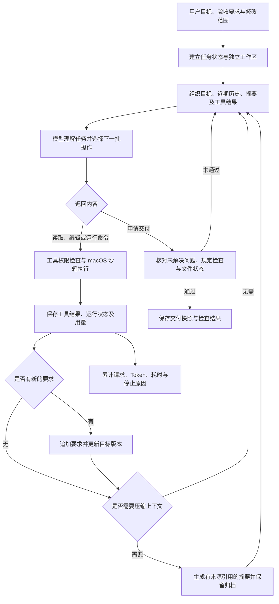

# GoalKeeper 2.2 · 简洁编码 Harness

**用尽可能少的模型往返，完成可以检查、可以追溯的长链路编码任务。**

GoalKeeper 独立调用模型、读写文件、执行命令和检查交付。它把目标、工具结果、上下文和交付证据放在一个持续运行的循环中，重点解决：工作跨多个模块、需求中途变化时，如何保持交付质量，同时减少整题耗时和 Token 消耗。

当前版本面向 macOS 上的编码和本地数据处理任务。桌面端正在规划，下载地址和桌面端使用说明将在完成后补充。

[框架与核心逻辑](#框架与核心逻辑) · [评测成果](#评测成果) · [安装使用](#安装使用) · [任务与完整结果](docs/benchmark-report.md)

## 评测成果

已完成 **16 道主要任务 × 4 组，共 64 次交付**。同题并行比较 GoalKeeper、Codex、OpenCode 和 Pi，模型统一使用 `gpt-6.1-sol / xhigh`。

### 复杂业务链路：保持质量，降低交付成本

实验分群分析、特征下线与恢复、小票审核与复审三题，四组均通过全部 **57 项固定质量检查**，且用量完整。GoalKeeper 的三题累计表现如下：

| 相比对照组 | 模型请求减少 | 累计耗时减少 | 总 Token 减少 |
|---|---:|---:|---:|
| Codex | 26.7% | **31.3%** | **60.2%** |
| OpenCode | 54.8% | **37.4%** | **73.9%** |
| Pi | 45.9% | **40.3%** | **64.3%** |

四组质量均通过、用量均完整的共同十题上，GoalKeeper 相比三个对照组减少 **54.4%—67.3% Token**，缩短 **26.2%—29.6% 累计耗时**。十题包含五道短诊断题；选取规则和逐题结果见[评测报告](docs/benchmark-report.md)。

### 工单工具的连续改造

L1-v1 要求迁移旧数据、批量预览与执行、处理版本冲突、实现查询与报表，再在同一会话增加撤销功能。优化后同轮四组均通过 **18/18 项**质量检查：

| 组别 | 请求次数 | 整题耗时 | 总 Token |
|---|---:|---:|---:|
| **GoalKeeper** | **11** | **5分54秒** | **146,933** |
| Codex | 17 | 8分30秒 | 456,969 |
| OpenCode | 22 | 8分56秒 | 513,978 |
| Pi | 21 | 10分31秒 | 510,970 |

### 已实测的工作场景

| 场景 | 前后关联的工作 |
|---|---|
| 推荐负反馈排查 | 关联请求日志、反馈、商品关系与画像，诊断同类商品仍出现的原因；增加图片反馈规则并保留原规则 |
| 实验分析口径升级 | 去重、分流和版本关联、漏斗及分群分析；增加用户口径并保留请求口径 |
| 特征下线与恢复 | 检查引用和依赖、备份、清理、核对；发现遗漏后恢复数据并接回业务 |
| 小票审核与复审 | OCR 纠错、重复小票识别、审核和奖励；改判后转移奖励并保持钱包与账目一致 |
| 工单系统改造 | 旧数据迁移、批量操作、版本控制、查询与报表、撤销和审计 |
| 请假审批与排班同步 | 员工提交、店长审批、数据库状态、排班及 API 同步，并保留旧接口 |

这些是基于实际工作场景设计的本地模拟任务，未连接公司生产系统。“长链路”指步骤存在依赖、需要持续修改和联调，不以运行分钟数直接认定人工长程难度。

完整统计区分正常交付、质量通过和旧系统兼容。64 次正常交付不等于所有质量项通过；优势比例来自质量通过且用量完整的匹配题目。不同批次对应不同实现快照，每题每组只选一轮，详细报告保留兼容性问题和 H1-v1 探索结果。

## 框架与核心逻辑



### 一个主循环，明确分工

模型理解业务、生成修改并分析失败；框架执行工具、维护状态、组织上下文、运行规定检查并决定是否允许交付。模型说“完成了”不能替代验收证据。

| 模块 | 职责 | 代码入口 |
|---|---|---|
| 执行循环 | 模型调用、工具执行、追加要求与交付 | [engine.py](src/goalkeeper/engine.py) |
| 上下文管理 | 稳定历史前缀、近期正文、摘要结构与来源校验 | [context.py](src/goalkeeper/context.py) |
| 工具与隔离 | 文件读写、原子编辑、命令运行及路径权限 | [tools.py](src/goalkeeper/tools.py)、[sandbox.py](src/goalkeeper/sandbox.py) |
| 状态与归档 | 原子保存、并发状态校验、归档与交付快照 | [storage.py](src/goalkeeper/storage.py) |
| 模型接入 | 独立 HTTP 请求、流式响应与本机授权 | [provider.py](src/goalkeeper/provider.py)、[auth.py](src/goalkeeper/auth.py) |
| 评测与计量 | 四组并行、固定评分、请求恢复和用量统计 | [evaluation.py](src/goalkeeper/evaluation.py)、[transport.py](src/goalkeeper/transport.py) |

**减少往返与重复输入。** 独立读取和写入可放在同一轮工具调用中；依赖前一步结果的操作按顺序执行。`edit_many` 一次修改同文件多处片段，任一替换不唯一则整份文件不写入。长命令输出保留首尾预览、状态和归档。

**长上下文仍可追溯。** 默认约 48,000 Token 触发压缩，保留近期约 20,000 Token 正文，摘要正文最多 2,000 Token。摘要包含目标、约束、已完成工作、决策、问题、后续动作和有效来源。历史可通过 `search_archive`、`read_archive` 找回。

**交付由检查和文件状态决定。** 证据关联目标版本、检查命令、文件内容和执行环境，文件变化后旧证据不能直接复用。规定检查通过且无未解决问题后保存交付。多轮要求在同一工作区继续执行，未来要求不会提前暴露。

核心采用独立模型与工具循环，没有强制阶段计划、子 Agent 或默认模型 Reviewer。三个对照产品运行各自的原生循环；GoalKeeper 核心不依赖它们。

## 安装使用

需要 macOS、Python 3.11 或 3.12，以及 [uv](https://docs.astral.sh/uv/)。命令工具使用 Seatbelt，当前不提供无沙箱回退。核心运行不需要 Node.js 或三个对照产品。

```bash
git clone https://github.com/jiajialearncool/goalkeeper-simple-harness.git
cd goalkeeper-simple-harness
UV_CACHE_DIR="$PWD/work/install-cache/uv" uv sync --locked
.venv/bin/python -m goalkeeper.cli --help
```

任务、配置和输出放在当前源码目录内。先执行不调用模型的检查：

```bash
.venv/bin/ruff check src scripts tests examples
TIKTOKEN_CACHE_DIR="$PWD/work/tokenizer-cache" \
  .venv/bin/python -m pytest tests/test_loop.py -q --basetemp=work/core-offline-check
```

完整 300 项回归包含原生产品接入和本机历史/外部题包检查，需要固定依赖及未公开夹具，见[开发说明](docs/development.md)。

### 准备任务并运行

公开版包含“按分类汇总金额”的最小示例。准备过程只写文件，不登录、不调用模型：

```bash
.venv/bin/python examples/prepare_demo.py
```

首次使用可启动本机授权页，连接自己的账户。凭据保存在系统钥匙串，不从其他 Agent 导入：

```bash
.venv/bin/python -m goalkeeper.cli login --port 8892
# 打开 http://127.0.0.1:8892/；授权完成后结束登录进程。
```

另开终端运行任务；下列命令会发起真实模型请求：

```bash
.venv/bin/python -m goalkeeper.cli run \
  --task "$PWD/examples/generated/task.json" \
  --source "$PWD/examples/generated/initial" \
  --config "$PWD/configs/default.json" --allow-real-model
```

任务定义包括目标、验收要求、修改路径、受保护文件和必需检查。可以修改示例定义自己的任务；当前 CLI 不自动把任意自然语言需求生成完整验收方案。

运行记录和交付位于 `runtime/runs/`。以下 `RUN_ID` 替换为命令输出的实际运行编号：

```bash
.venv/bin/python -m goalkeeper.cli report --run "$PWD/runtime/runs/RUN_ID"
.venv/bin/python -m goalkeeper.cli resume --run "$PWD/runtime/runs/RUN_ID" --allow-real-model
```

恢复核对记录和未完成工具事务，保留原截止时间，不重新开始一轮评测。

### 默认配置

[configs/default.json](configs/default.json) 固定 `gpt-6.1-sol / xhigh`，每任务最多 1,800 秒；累计 Token 和摘要累计额度为 `null`，只统计、不因累计用量停止。上下文大小、命令超时、必要检查和取消清理仍保留。切换模型需要修改配置校验并适配验证。

## 更多资料

- [架构与执行规则](docs/architecture.md)
- [任务清单、逐组结果及统计依据](docs/benchmark-report.md)
- [结构化评测数据](docs/benchmark-results.json)
- [开发、固定依赖与四组评测流程](docs/development.md)
- [发布来源与检查记录](docs/publication.json)

展示结构参考 [LongHorizon-Harness](https://github.com/AMAP-ML/LongHorizon-Harness)；执行逻辑以本仓库源码为准。
