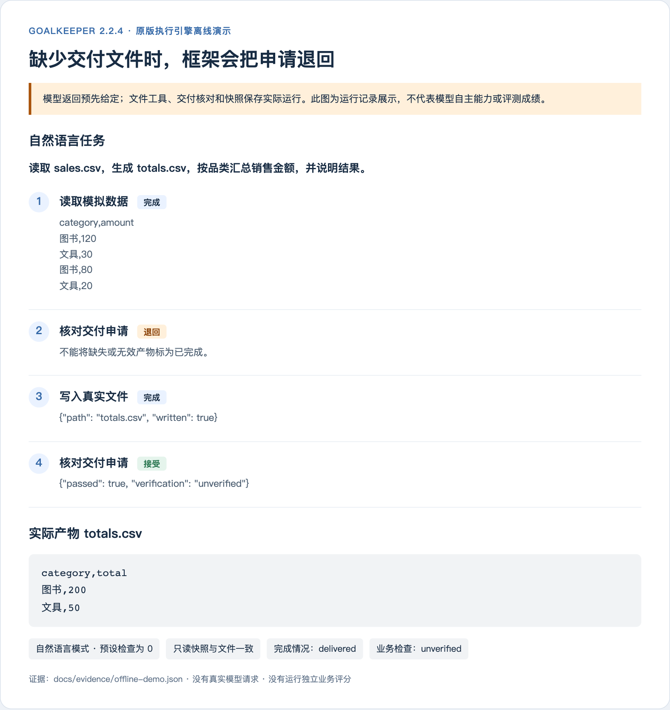
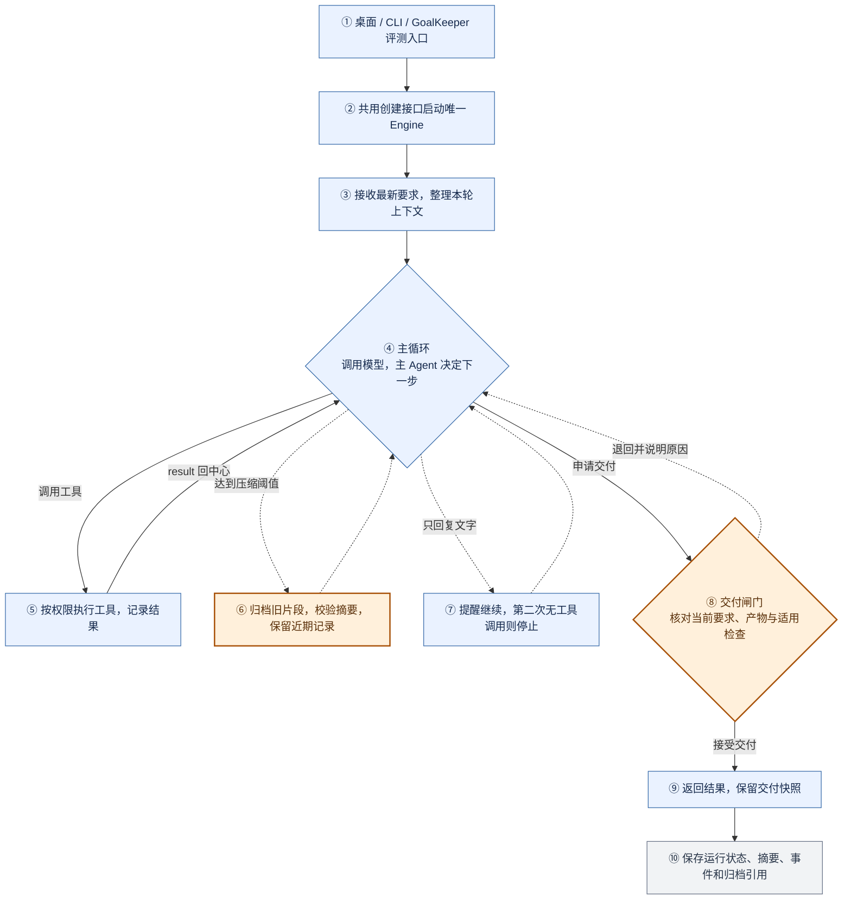

# GoalKeeper 2.2.4

**把任务要求保留下来，让模型调用工具持续完成工作，并在交付前用真实文件和有效检查记录核对结果。**

GoalKeeper 是模型外面的执行框架（Harness）。模型负责理解需求、决定下一步和生成内容；框架负责执行工具、限制文件访问、保存任务状态、压缩过长历史，以及核对交付申请。项目采用单主 Agent：由一个持续处理当前任务的模型角色负责决策，没有子 Agent 编排。

首批关注有明确交付物、步骤相互依赖、过程中可能追加要求的任务，例如改造工单工具、排查推荐问题和生成分析报告。项目希望减少三种失败：忘记早期要求、缺少产物就宣布完成、反复发送长材料造成额外消耗。实际收益见下方评测，适用范围以样本为限。

> [!NOTE]
> 本仓库整理的是留存应用包中经过校验的 **2.2.4 源码**。新增的说明、示例和发布检查均单独记录。历史评测包含更早的实现快照，不能全部视为本仓库源码的重测。[版本来源](docs/provenance.md)

[运行流程](#一次任务怎样运行) · [设计取舍](#三个关键设计) · [评测结果](#评测实际说明了什么) · [动手运行](#如何运行) · [源码与证据](docs/evidence-index.md)

## 先看一次实际引擎运行



演示任务：“读取 sales.csv，生成 totals.csv，按品类汇总销售金额，并说明结果。”第一次交付申请没有提供 totals.csv，框架拒绝；真实文件工具生成文件后，第二次申请通过，并保存一份不可直接修改的文件副本，称为交付快照。

**演示中的模型返回预先写好，文件操作和交付核对由原版引擎实际执行。** 演示用于检查执行流程，不代表模型自主完成能力或评测成绩。[查看运行证据](docs/evidence/offline-demo.json) · [运行同一示例](examples/offline_demo.py) · [历史任务成功与失败案例](docs/cases.md)

## 一次任务怎样运行

用户用自然语言提出要求。串起任务的执行引擎（Engine）在下面的循环中工作。四步是对图中十个环节的分组；归档压缩等分支按条件发生，运行状态也会在过程中持续保存。



1. **任务进入与初始化（①②③）**：桌面、命令行入口（CLI）和 GoalKeeper 评测入口共用执行引擎。框架确定工作目录、可写范围和时间上限，组织模型这一轮能看到的全部材料，也就是上下文。
2. **主循环与模型决策（④）**：模型阅读任务要求、运行规则、摘要和近期记录，决定调用工具、回复文字或申请交付。用户中途追加的要求会被记录，交付时继续核对。
3. **执行工具，历史太长就压缩（⑤⑥⑦）**：工具按权限读写文件或执行命令。历史达到压缩条件时，框架先原样归档旧片段，再生成摘要，带着摘要和近期记录继续。只回复文字不会自动变成已交付。
4. **交付核对与收尾（⑧⑨⑩）**：模型正式申请交付，框架根据任务模式核对真实产物和适用检查。通过后保存文件快照及运行记录；交互任务明确提交未完成事项时，可以交回部分结果，状态会保留未完成项。

[四步详解、参数与源码入口](docs/architecture.md)

## 三个关键设计

| 具体问题 | GoalKeeper 怎么处理 | 与竞品相比关注的差别 | 好处与代价 |
|---|---|---|---|
| 中途追加要求后，旧要求被遗漏 | 保存当前任务和追加消息，另存可机械识别的要求，交付时核对 | 竞品也保存会话和接收新消息；GK 进一步把部分文件、数量、检查要求放进交付核对 | 减少可检查要求的遗漏；文字匹配规则无法理解全部业务语义 |
| 模型自称完成，实际产物缺失 | 模型申请交付后，框架检查文件与有效检查记录，符合条件才接受 | Codex 的停止钩子、Pi 的可选停止回调、OpenCode V1 的结束处理各有用途；GK 将交付申请与结果核对相连 | 缺文件等问题能在交付时退回；多一道协议与执行开销，开放式内容仍需人判断 |
| 每轮输入重复，工具请求过碎 | 旧片段归档后压缩，已确定的操作可以批量提交 | Pi 也有摘要与近期记录，Codex 有多种压缩路径；GK 的摘要、原文和压缩记录在本地文件层可核对 | 便于排查，可能减少重复输入和请求；压缩有额外模型开销，批量执行失败时已完成步骤不会自动撤销 |

以上属于实现与设计取舍；尚未分别关闭某项设计再做对照，因此不能确定每项设计各自带来多少收益。竞品比较限定版本与已读到的一手代码，详见[逐项对比与证据](docs/comparison.md)。

### 普通聊天与评测怎样区分

- **自然语言交付（interactive）**：用户照常描述任务，无需手写检查清单。框架从原话中机械识别部分文件、数量、图表和检查要求；已识别要求对应真实产物，才能记为完成。文字答案的语义质量仍由人判断。
- **预设检查交付（checked）**：把任务交给框架的人，在评测或标准化部署前提供自然语言验收标准（acceptance）和可执行检查命令（checks）。框架逐项运行适用检查，通过后才接受交付。答题 Agent 不负责编写这套评分标准。

规则抽取不会自动生成 assert 检查脚本。框架也没有实现“任意自然语言目标自动变成客观验收脚本”的完整能力。[交付边界](docs/architecture.md#交付核对具体能保证什么)

## 评测实际说明了什么

Token 是模型处理文字的计量单位。下面同时看任务结果、耗时和 Token，避免只展示某个漂亮数字。

### 历史自建 16 题：较早版本的同模型对照

固定模型为 gpt-6.1-sol / xhigh，比较 GoalKeeper、Codex、OpenCode、Pi，每题每组选一轮，共 64 次运行。四组都为 16/16 正常交付；质量检查、旧接口兼容与成本另行统计。**这套成绩来自历史公开评测记录，非 2.2.4 全量重测。**

四组质量符合比较要求且用量完整的共同十题中，GoalKeeper 相比 Codex 累计耗时减少 26.2%、Token 减少 59.9%。十题含五道低复杂度任务；选择规则、其余对照与逐题失败均在[完整报告](docs/evaluation/historical-16.md)。该比例不能推广到所有任务，也不能单独归因于压缩。

### Terminal-Bench 2.1：保留各批结果

各批使用 gpt-5.6-sol / medium，按题目自带时限和官方验收判分。以下只列报告标为 2.2.4 的批次；批次间有冻结结果复用和源码记录缺口。

| 批次 / 每组题数 | GK 2.2.4 官方验收通过 | 题包 Harness | Codex | Pi | 需要一起看见的事实 |
|---|---:|---:|---:|---:|---|
| 第二批 / 5 | 5/5 | 5/5 | 4/5 | 4/5 | GK 比题包更慢；Codex 用量不完整 |
| 第三批 / 5 | 4/5 | 4/5 | 3/5 | 4/5 | GK 未取得耗时或 Token 优势 |
| 第四批 / 5 | 5/5 | 5/5 | 4/5 | 5/5 | 题包更快，Pi Token 更少 |
| 第五批 / 5 | 4/5 | 4/5 | 5/5 | 5/5 | GK 未通过 MIPS 解释器任务 |

第一批的 GK 为 2.2.2，另列历史记录。所有批次的耗时、Token、替换题目和版本限制见[分批评测](docs/evaluation/terminal-bench.md)。这些是本地选题运行记录，未宣称为官方排行榜成绩。

## 如何运行

命令执行目前依赖 macOS Seatbelt 文件与进程沙箱，使用 Python 3.11 或 3.12。发布候选提供源码工作目录运行方式；完整桌面应用暂未作为可重新打包的公开成品提供。

```bash
python3.12 -m venv .venv
.venv/bin/python -m pip install --require-hashes -r requirements.txt
PYTHONPATH=src .venv/bin/python -m goalkeeper.cli --help
PYTHONPATH=src .venv/bin/python examples/offline_demo.py
```

离线示例不登录、不请求模型；首次使用分词器可能需要下载公开词表。需要用真实模型时，先按[安装与复现说明](docs/reproduce.md)连接自己的账户，再运行自然语言示例。实际可用模型、账户权限和接口状态需要在自己的环境核实。

## 已知不足与后续方向

- **识别范围有限**：文件存在、文件格式和已有测试通过，都不能直接证明业务解释正确、文案有说服力。
- **旧对话自动读回有缺口**：已登记网页/文档可按关键词检索、读回；被压缩的旧对话原文虽已归档，当前模型工具没有接通这类读回。
- **单主 Agent 的代价**：多个任务分支共享一个决策循环，缺少独立子 Agent 分工；只有满足条件的只读工具批次可并行。
- **证据与复现有边界**：原始私有题目、隐藏评分器和全部运行记录不随仓库公开。公开报告可以核对汇总，尚不能一键复跑全部历史成绩。
- **后续方向**：更好的自然语言要求识别、通用检查接入、旧对话检索读回、更多重复评测与单项设计对照。上述方向未作为本版已完成功能。

## 个人贡献与 AI 辅助开发

从保留的对话看，项目发起人推动了“先建立简洁循环、用完成率/耗时/Token 判断效果、根据实际失败再增加控制”的产品方向，持续审查评测、范围和表达。具体方案推演、源码实现与排错有 AI 参与，复用了第三方依赖。各项贡献按记录区分，未将整套技术方案或全部代码描述为个人独立完成。[决策记录与职责说明](docs/contribution.md)

## 继续查看

[源码导航与证据索引](docs/evidence-index.md) · [版本来源](docs/provenance.md) · [面试浏览顺序](docs/interview-guide.md) · [本地验证记录](docs/validation.md) · [第三方与许可证说明](THIRD_PARTY_NOTICES.md)
