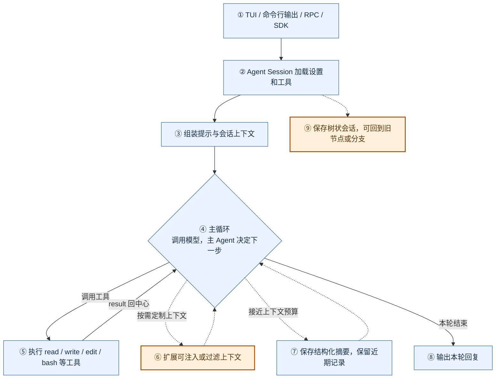
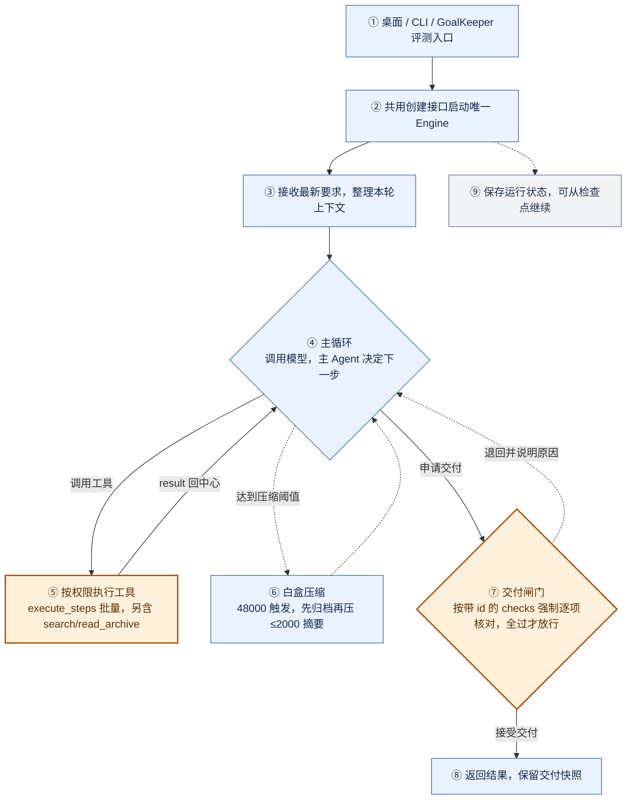
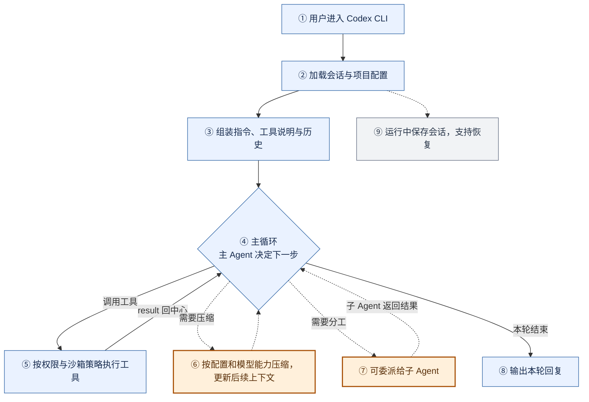
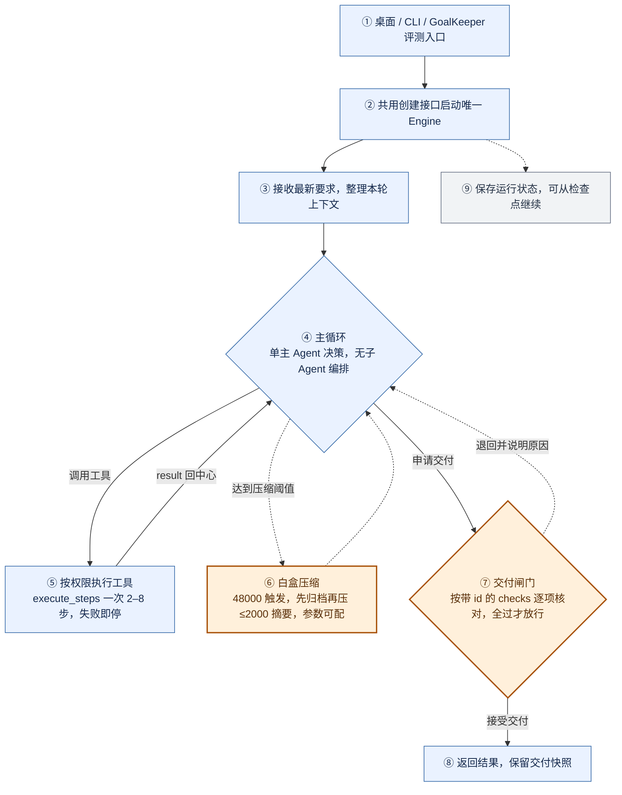

# 与 Pi、Codex、OpenCode 的设计对比

[返回首页](../README.md)

**核心差别在框架把什么固定下来、交给谁判断，以及为此多付出什么。** 各家都有运行循环、工具与结束处理，不能将某个默认路径没有业务清单，写成整个产品没有验收能力。

## 比较版本和证据范围

| 对象 | 锁定标签 | 本次解析的提交 | 使用范围 |
|---|---|---|---|
| codex | rust-v0.159.0 | `687a119f0fcaace47e1f1abcc77cec6c813fd6da` | 本地 CLI 源码；不外推云端或 Agents API |
| pi | v0.73.1 | `781152fc24841dc54b22284514604048ebe5e2c9` | 本版本一手源码；不外推全部历史运行身份 |
| opencode-v1 | v1.18.34 | `aec0b9a6d8898f68f923aaf08b7306d931fd9d76` | 本版本一手源码；不外推全部历史运行身份 |
| opencode-v2 | v2.2.0 | `1097e2668b1e08ad63bdf0b1c4860b9bc01e420c` | 仅单列来源，不用于本文已确认机制 |

本次重新读取了固定提交下的关键文件，源码路径与函数以实际文件为准。OpenCode V2 的标签已解析，但本次沿用的 V1 路径在 V2 下没有读到对应文件，V2 具体实现暂不用于结论；没有把 V2 当成历史 V1 实测能力。全部已读取文件的哈希见[外部源码证据清单](evidence/competitor-evidence.json)。

## 与 Pi 的框架对比

**一句话结论：Pi 优先保留可扩展的会话与上下文处理，GoalKeeper 在持续执行同一个任务的同时，增加了按已识别要求核对交付的约束。** 两者都可以保存会话和压缩历史。

### 【图2：Pi 的执行循环与会话扩展（9 环节）】

### 【图3：GoalKeeper 连续执行与交付核对（对 Pi，9 环节）】

> [!NOTE]
> 此图交付节点展示预设检查模式；自然语言模式见[主流程说明](architecture.md#交付核对具体能保证什么)。图中 checks 为可执行检查命令，由评测或部署任务的人提供，普通用户无需手写。图内源码保持定稿原文。

### 差异一：输入给模型的材料怎样调整（Pi⑥⑦ / GK⑥）

1. **Pi 怎么做**：模型请求前可以通过 transformContext 改写或过滤材料，再由 convertToLlm 转成模型输入。Pi 的自动压缩另有 shouldCompact 和 findCutPoint；v0.73.1 默认预留16384 Token、保留近期目标20000 Token，触发判断为当前用量大于模型窗口减预留量。findCutPoint 属于⑦的压缩切分，不能当作⑥的扩展过滤函数。[runLoop / streamAssistantResponse](https://github.com/earendil-works/pi/blob/781152fc24841dc54b22284514604048ebe5e2c9/packages/agent/src/agent-loop.ts#L219)；[shouldCompact / findCutPoint / generateSummary](https://github.com/earendil-works/pi/blob/781152fc24841dc54b22284514604048ebe5e2c9/packages/coding-agent/src/core/compaction/compaction.ts#L121)。
2. **GK 怎么做**：按[前文](architecture.md#第三步执行工具历史太长就压缩⑤⑥⑦)的规则在本地归档原文、校验摘要。2.2.4 默认48000 Token尝试压缩、摘要上限2000 Token；具体保留长度还有任务类型分支。[compact](../src/goalkeeper/runtime/research.py#L57)
3. **为什么这样做**：本项目希望排查失败时能把原文、摘要与来源对照，发现哪项要求在持续运行中被遗漏，而无需依赖模型自述。
4. **差异、好处和代价**：Pi 强调可替换的上下文处理及会话重建，GK 将摘要结构与来源校验固定在共用执行路径。GK 的记录更便于按本项目规则检查；代价是规则更固定、摘要需要额外模型请求。Pi 自身也保存本地会话，不能把“本地可见”写成 GK 独有。

### 差异二：回到旧节点，还是从任务检查点继续（Pi⑨ / GK⑨）

1. **Pi 怎么做**：SessionManager 保存带 id/parentId 的会话条目，branch 可以把当前位置切回旧节点，后续消息形成新分支，原记录保留。[SessionManager.branch / buildSessionContext](https://github.com/earendil-works/pi/blob/781152fc24841dc54b22284514604048ebe5e2c9/packages/coding-agent/src/core/session-manager.ts#L1125)。
2. **GK 怎么做**：围绕当前任务状态保存进度、要求、工具结果与交付证据，从允许的检查点继续；没有提供 Pi 式任意会话树节点导航界面。[检查点接口](../src/goalkeeper/runtime/checkpoints.py)、[Runtime.continue_run](../src/goalkeeper/runtime/session.py)
3. **为什么这样做**：首批任务更关注同一份交付物在追加要求后继续修改，框架需要明确当前目标版本及哪些检查仍然有效。
4. **差异、好处和代价**：Pi 的树状会话方便尝试不同方案并回到旧路线；GK 更集中维护当前任务与检查点，减少需要解释的分支状态。代价是探索多个路线、比较不同分支的体验较弱。

### 差异三：何时停止，怎样接受交付（Pi⑧ / GK⑦）

1. **Pi 怎么做**：每轮结束可调用 shouldStopAfterTurn，可选回调收到本轮消息、工具结果与上下文后决定是否停止。没有配置回调时，这个位置不会自动变成业务验收清单。[runLoop / streamAssistantResponse](https://github.com/earendil-works/pi/blob/781152fc24841dc54b22284514604048ebe5e2c9/packages/agent/src/agent-loop.ts#L219)。
2. **GK 怎么做**：模型申请交付后，框架核对已识别要求；预设检查模式强制跑适用 checks，自然语言模式核对文件、有效检查和答案。模型缺少文件却声称完成时，框架可退回。[delivery](../src/goalkeeper/engine.py#L353)、[review](../src/goalkeeper/runtime/completion.py#L228)
3. **为什么这样做**：在“生成 totals.csv”这种明确要求下，结束回复和文件实际存在需要分开判断；本仓库[离线示例](evidence/offline-demo.json)直接展示了先退回、后接受。
4. **差异、好处和代价**：Pi 提供可编程停止入口，GK 把部分结果核对做成执行框架的固定交付步骤。GK 少依赖接入方再写这一层，但多一道申请协议，且仅能判断已覆盖的客观要求。Pi 可以通过扩展加入验收，不能写成 Pi 无法验收。

从现有资料看，Pi 的优势是简洁核心与可扩展会话；GK 的重点是持续任务中的显式要求和交付记录。扩展自由与固定约束各有维护成本，当前样本没有证明一种方式普遍更好。Pi 核心不内置子 Agent，扩展可以另做；GK 同样没有子 Agent 编排。[Pi v0.73.1 设计取舍](https://github.com/earendil-works/pi/blob/781152fc24841dc54b22284514604048ebe5e2c9/packages/coding-agent/README.md#L472)。

## 与 Codex 的框架对比

**一句话结论：Codex 本地 CLI 提供更丰富的会话、压缩与可选委派能力，GoalKeeper 选择单主 Agent，并把任务要求和交付证据集中在同一套运行状态中。**

### 【图4：Codex CLI 执行循环与可选委派（9 环节）】

### 【图5：GoalKeeper 可检查归档与单主 Agent 交付（对 Codex，9 环节）】

> [!NOTE]
> 此图交付节点展示预设检查模式；自然语言模式见[主流程说明](architecture.md#交付核对具体能保证什么)。图内源码原样保留，图中数值为对应 2.2.4 默认配置与 execute_steps 限制。

### 差异一：任务分工（Codex⑦ / GK④）

1. **Codex 怎么做**：handle_spawn_agent 为子 Agent 准备配置并创建子线程，可按角色、模型和上下文继承方式分工。[handle_spawn_agent](https://github.com/openai/codex/blob/687a119f0fcaace47e1f1abcc77cec6c813fd6da/codex-rs/core/src/tools/handlers/multi_agents/spawn.rs#L53)。
2. **GK 怎么做**：只有一个主 Agent 处理当前任务，工具执行与摘要调用围绕同一个 Engine；没有派发给独立子 Agent 的编排路径。[create_engine](../src/goalkeeper/runtime/factory.py)、[Engine.run](../src/goalkeeper/engine.py#L587)
3. **为什么这样做**：项目先集中验证一个任务的要求保存、工具执行和交付核对，避免同时引入分工、结果合并和多份材料维护。
4. **差异、好处和代价**：Codex 可以把任务交给独立子线程，GK 保持一条主要决策循环。GK 少了跨角色交接，运行更容易追查；代价是缺少对子任务的独立分工。Codex 的子 Agent 是可选能力，并不自动等于每次交付都有强制独立复核；也不能据子 Agent 存在就认定成本更高。

### 差异二：压缩路径与开发者能看到什么（Codex⑥ / GK⑥）

1. **Codex 怎么做**：rust-v0.159.0 的 ModelInfo.auto_compact_token_limit 以解析后的窗口乘9/10，并与显式配置取小；不能写成统一95%。主循环还按功能与提供方能力选择压缩路径。文本摘要路径有20000 Token的用户消息保留参数；远端V2路径有64000 Token的消息保留额度，两者含义不同，均不能解释为统一“保留最近这么多对话”。[ModelInfo.auto_compact_token_limit](https://github.com/openai/codex/blob/687a119f0fcaace47e1f1abcc77cec6c813fd6da/codex-rs/protocol/src/openai_models.rs#L525)；[run_turn / run_auto_compact](https://github.com/openai/codex/blob/687a119f0fcaace47e1f1abcc77cec6c813fd6da/codex-rs/core/src/session/turn.rs#L649)；[run_inline_auto_compact_task / build_compacted_history](https://github.com/openai/codex/blob/687a119f0fcaace47e1f1abcc77cec6c813fd6da/codex-rs/core/src/compact.rs#L55)；[run_inline_remote_auto_compact_task / RETAINED_MESSAGE_TOKEN_BUDGET](https://github.com/openai/codex/blob/687a119f0fcaace47e1f1abcc77cec6c813fd6da/codex-rs/core/src/compact_remote_v2.rs#L75)。
2. **GK 怎么做**：本地先归档原文，生成并校验限定结构的摘要；参数及压缩产物在本地文件层可检查。[compact](../src/goalkeeper/runtime/research.py#L57)、[默认配置](../configs/default.json)
3. **为什么这样做**：框架开发者希望按同一套文件记录排查压缩前后遗漏的要求，并明确摘要是否满足本项目的结构与来源规则。
4. **差异、好处和代价**：Codex 同时有客户端可见的文本摘要和远端压缩路径；远端服务内部怎样压缩，不能从客户端源码完整看到。GK 采用项目自身的本地归档与摘要校验，便于核对但需要自己维护质量和恢复规则。不能将整个 Codex 描述成全部黑盒、配置不可改或历史无法恢复。

Codex 保存会话记录并支持恢复，保存路径与记录模块可追溯到 [RolloutRecorder 与已保存会话路径接口](https://github.com/openai/codex/blob/687a119f0fcaace47e1f1abcc77cec6c813fd6da/codex-rs/core/src/rollout.rs#L1)。服务端加密算法、压缩旧原文能否被模型自动找回，本次材料无法确认；GK 被压旧对话的模型工具读回也尚未接通。

### 差异三：收尾拦截与结果核对（Codex⑧ / GK⑦）

1. **Codex 怎么做**：run_turn 在无需继续工具调用时运行 run_turn_stop_hooks。停止钩子是轮末运行的扩展处理，可以返回拦截结果和继续提示，让模型继续；具体条件取决于已配置处理。[run_turn_stop_hooks](https://github.com/openai/codex/blob/687a119f0fcaace47e1f1abcc77cec6c813fd6da/codex-rs/core/src/hook_runtime.rs#L392)；[run_turn / run_auto_compact](https://github.com/openai/codex/blob/687a119f0fcaace47e1f1abcc77cec6c813fd6da/codex-rs/core/src/session/turn.rs#L649)。
2. **GK 怎么做**：由模型提交交付申请，框架按任务模式核对真实文件、已识别要求和有效检查，之后保存快照。[delivery](../src/goalkeeper/engine.py#L353)
3. **为什么这样做**：本项目要追查“用户要求的东西到底交出来没有”，因此保留要求及相应证据，而不单独依赖结束信号。
4. **差异、好处和代价**：Codex 提供可按配置拦截结束的钩子，GK 内置与任务要求相连的机械交付核对。GK 对已覆盖要求更直接，代价是更严格的交付协议与额外检查时间。开发者也可在 Codex 钩子接入业务检查；所查常规路径中未见自动生成业务结果带id清单并逐项核对，不能扩大为产品没有验收能力。

### 差异四：顺序已经确定的操作怎样少问几轮（GK⑤）

Codex 提供工具执行与可选委派；已读代码不足以据此断言 Codex 不支持批量或并行工具。GK 的明确实现是 execute_steps：一次提交2–8步已知顺序，遇错误、超时或非零退出码就停止剩余步骤。好处是减少中间模型往返；代价是后一步仍需观察前一步再决定时不适用，已执行修改不会自动撤销，success_condition 字段也不等于可执行业务断言。[Engine.execute_steps](../src/goalkeeper/engine.py#L542)

从现有资料看，Codex 的可选分工与压缩路径更丰富；GK 选择较集中的单任务状态及交付规则。集中状态便于追查，灵活分工能力较弱，实测收益按各批样本判断。

## OpenCode V1：补足第三个对照

**一句话结论：OpenCode V1 在会话、工具和子会话之间提供可配置能力，GoalKeeper 更集中于单任务的要求与交付证据。** 以下均属于 v1.18.34，不代表 V2。

| 对应问题 | OpenCode V1 的一手行为 | GK 2.2.4 的做法 | 差别、好处和代价 |
|---|---|---|---|
| 工具未处理就停止 | 结束原因已到终点、没有待处理工具、对应最新用户消息时才退出；结构化输出另有格式要求 | 正式申请交付，按已捕获要求检查文件与适用证据 | OpenCode所查路径处理流程和格式完整性；GK再加入结果要求核对，但覆盖范围有限 |
| 材料太长 | 按模型可用窗口判断溢出；修剪旧工具输出并压缩，保留近期长度可配置 | 先归档，再按固定结构校验摘要 | 两者均管理长材料；GK便于按本项目记录对照，额外承担摘要维护成本 |
| 需要分工 | 内置 General/Explore 子代理，创建子会话并派生权限 | 单主Agent，不创建分工子会话 | OpenCode分工更灵活，GK交接更少；不能据此断言操作系统进程隔离 |

来源：[SessionPrompt 的循环停止判断](https://github.com/sst/opencode/blob/aec0b9a6d8898f68f923aaf08b7306d931fd9d76/packages/opencode/src/session/prompt.ts#L1100)；[usable / isOverflow](https://github.com/sst/opencode/blob/aec0b9a6d8898f68f923aaf08b7306d931fd9d76/packages/opencode/src/session/overflow.ts#L8)；[preserveRecentBudget / prune](https://github.com/sst/opencode/blob/aec0b9a6d8898f68f923aaf08b7306d931fd9d76/packages/opencode/src/session/compaction.ts#L115)；[内置 general / explore 定义](https://github.com/sst/opencode/blob/aec0b9a6d8898f68f923aaf08b7306d931fd9d76/packages/opencode/src/agent/agent.ts#L182)；[TaskTool.execute 子会话与权限派生](https://github.com/sst/opencode/blob/aec0b9a6d8898f68f923aaf08b7306d931fd9d76/packages/opencode/src/tool/task.ts#L135)。

V1 的 preserveRecentBudget 默认按模型可用输入长度的四分之一取值，并限制在2000–15000 Token范围，显式 preserve_recent_tokens 可以覆盖；15000是这条默认计算的上界，不能写成固定保留量或8K。默认专门子代理为General/Explore，没有从这份定义中读到Scout；配置仍可扩展自定义角色。

OpenCode V2 v2.2.0 只保留为单独版本记录，本文未据未读取的V2文件写机制或参数。服务端加密算法、任意被压原文自动找回、子代理独立进程隔离均标为无法确认，不用于宣称GK优势。

## 已确认条目与适用范围

| 条目 | 状态 | 一手依据与限定 |
|---|---|---|
| Pi可选停止回调 | 已确认 | [runLoop / streamAssistantResponse](https://github.com/earendil-works/pi/blob/781152fc24841dc54b22284514604048ebe5e2c9/packages/agent/src/agent-loop.ts#L219)；是否加入业务检查由接入方决定 |
| Pi树状会话与压缩切分 | 已确认 | [SessionManager.branch / buildSessionContext](https://github.com/earendil-works/pi/blob/781152fc24841dc54b22284514604048ebe5e2c9/packages/coding-agent/src/core/session-manager.ts#L1125)；[shouldCompact / findCutPoint / generateSummary](https://github.com/earendil-works/pi/blob/781152fc24841dc54b22284514604048ebe5e2c9/packages/coding-agent/src/core/compaction/compaction.ts#L121) |
| Codex停止钩子可请求继续 | 已确认 | [run_turn_stop_hooks](https://github.com/openai/codex/blob/687a119f0fcaace47e1f1abcc77cec6c813fd6da/codex-rs/core/src/hook_runtime.rs#L392)；[run_turn / run_auto_compact](https://github.com/openai/codex/blob/687a119f0fcaace47e1f1abcc77cec6c813fd6da/codex-rs/core/src/session/turn.rs#L649)；按配置执行 |
| Codex多条压缩路径及90%基础阈值 | 已确认 | [ModelInfo.auto_compact_token_limit](https://github.com/openai/codex/blob/687a119f0fcaace47e1f1abcc77cec6c813fd6da/codex-rs/protocol/src/openai_models.rs#L525)；[run_inline_remote_auto_compact_task / RETAINED_MESSAGE_TOKEN_BUDGET](https://github.com/openai/codex/blob/687a119f0fcaace47e1f1abcc77cec6c813fd6da/codex-rs/core/src/compact_remote_v2.rs#L75)；[run_inline_auto_compact_task / build_compacted_history](https://github.com/openai/codex/blob/687a119f0fcaace47e1f1abcc77cec6c813fd6da/codex-rs/core/src/compact.rs#L55)；另有路径/能力条件 |
| Codex可选子Agent | 已确认 | [handle_spawn_agent](https://github.com/openai/codex/blob/687a119f0fcaace47e1f1abcc77cec6c813fd6da/codex-rs/core/src/tools/handlers/multi_agents/spawn.rs#L53)；不自动等于强制独立验收 |
| OpenCode V1结束处理、压缩、子会话 | 已确认 | [SessionPrompt 的循环停止判断](https://github.com/sst/opencode/blob/aec0b9a6d8898f68f923aaf08b7306d931fd9d76/packages/opencode/src/session/prompt.ts#L1100)；[preserveRecentBudget / prune](https://github.com/sst/opencode/blob/aec0b9a6d8898f68f923aaf08b7306d931fd9d76/packages/opencode/src/session/compaction.ts#L115)；[TaskTool.execute 子会话与权限派生](https://github.com/sst/opencode/blob/aec0b9a6d8898f68f923aaf08b7306d931fd9d76/packages/opencode/src/tool/task.ts#L135) |
| 三家所查常规路径默认自动逐项业务验收 | 未见实现 | 仅限上述核查路径；扩展、钩子与接入方可以增加能力 |
| OpenCode V2具体实现、服务端加密、子Agent进程隔离 | 无法确认 | 本文不以这些条目得出优势结论 |
